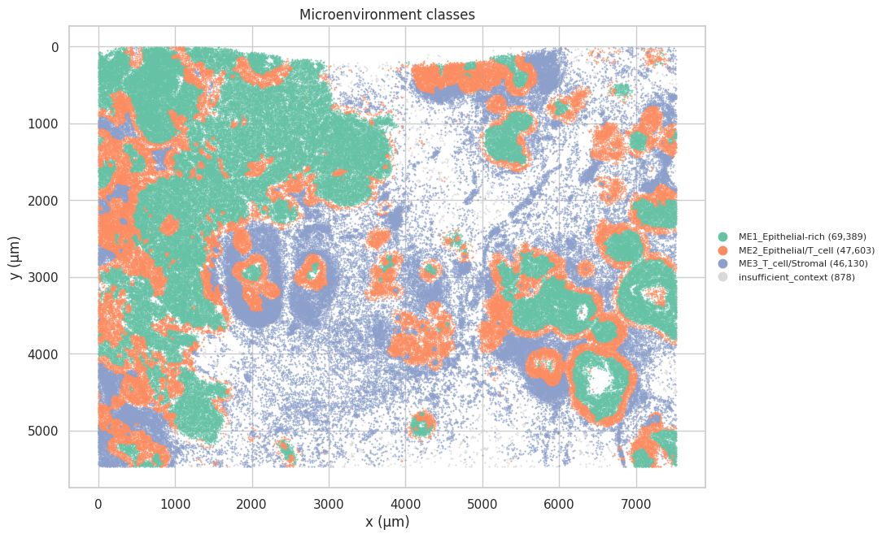
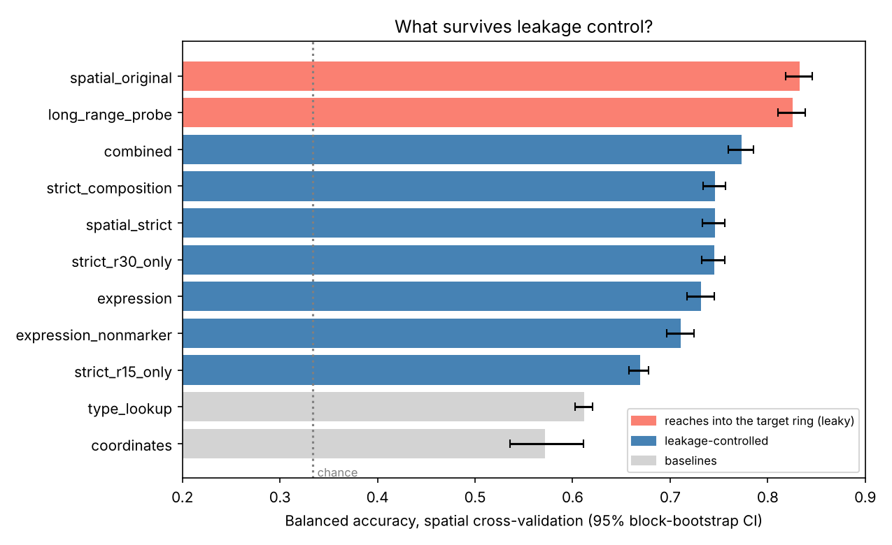
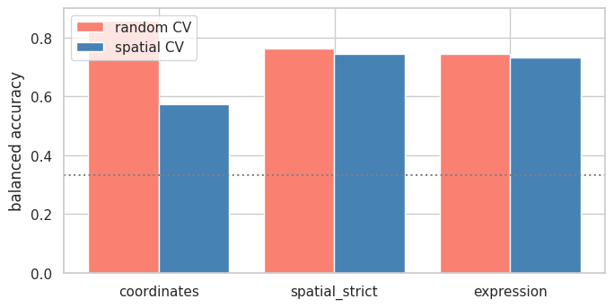
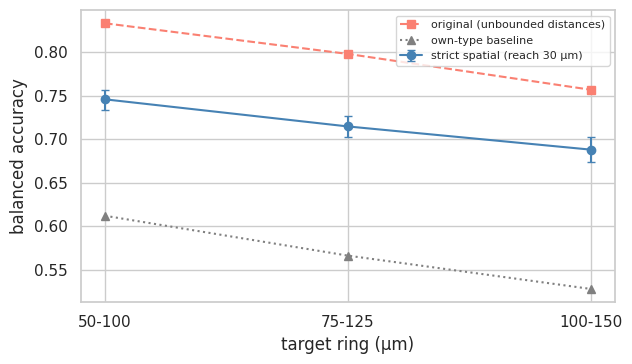
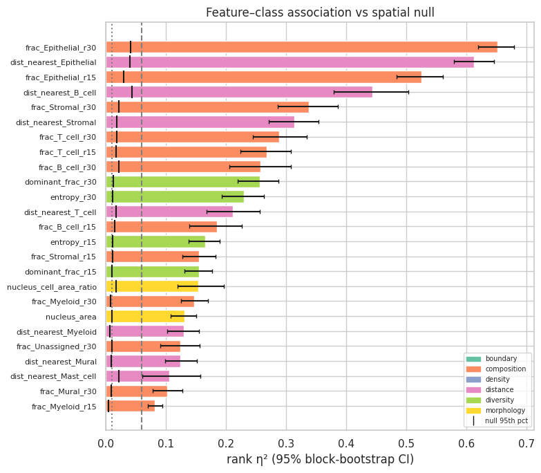

# Leakage-safe spatial machine learning on Xenium breast cancer data


Can the cellular neighbourhood of a cell predict the type of tissue microenvironment around it, **beyond what its own gene expression tells us**?
This project answers that on a public Xenium FFPE breast cancer section (164,000 cells, 313 genes) and focuses on making the answer *defensible*: leakage is audited and tested, evaluation is spatially separated, and uncertainty is estimated at the level of tissue blocks.

## Key results
| Features | Balanced accuracy (95% CI) |
|---|---|
| Own cell type only (cross-validated baseline) | 0.612 (95% CI 0.602-0.621) |
| Coordinates (x, y) only | 0.572 (95% CI 0.536-0.611) |
| Long-range distances only (leakage probe) | 0.825 (95% CI 0.810-0.839) |
| Spatial, original (unbounded distances; **leaky**) | 0.833 (95% CI 0.818-0.846) |
| Spatial, strict (reach <= 30 um) | 0.746 (95% CI 0.733-0.756) |
| Strict spatial, 15 um features only | 0.669 (95% CI 0.658-0.678) |
| Strict spatial, 30 um + capped distances | 0.745 (95% CI 0.732-0.756) |
| Strict neighbour composition only | 0.746 (95% CI 0.733-0.756) |
| Expression only (own transcriptome) | 0.731 (95% CI 0.717-0.745) |
| Expression excluding marker genes | 0.711 (95% CI 0.697-0.725) |
| Strict spatial + expression | 0.773 (95% CI 0.759-0.785) |

* Strict spatial features vs the own-cell-type baseline: +0.133 (95% CI +0.124 to +0.143) (spatial features outperform the baseline).
* Adding spatial features to expression: +0.042 (95% CI +0.035 to +0.049) (a detectable gain in this section); adding expression to spatial features also helps (+0.027 (95% CI +0.022 to +0.033)).
* **Leakage caught and fixed:** unbounded nearest-type distances reach into the target ring; capping them at 30 um changed balanced accuracy from 0.833 (95% CI 0.818-0.846) to 0.746 (95% CI 0.733-0.756).
* Results were stable across buffer size, block size and partition seed; accuracy decreased monotonically as the target ring moved away from the cell but stayed above the own-type baseline (see `reports/scientific_report.md`).
* **Caveat:** one tissue section, exploratory.


*Microenvironment classes on the tissue section: epithelial-rich nests (ME1) with epithelial/T-cell interface rims (ME2) inside T-cell/stromal tissue (ME3)*


*What survives leakage control: feature sets under spatial cross-validation*


*Random vs spatial cross-validation*


*Performance as the target ring moves away from the cell*


*Feature-class association against a spatial null model*

## Why this repository is different
* **Reach guarantee, tested:** `spatialml.features.reach_test` deletes every cell beyond 30 um from a focal cell and checks that its features do not change.
* **Rules enforced in code:** feature reach < target ring start; CV buffer >= target ring outer radius (`spatialml.config.validate_config`).
* **Spatial cross-validation with buffer**, block-bootstrap confidence intervals, paired model comparisons, spatial null models.
* **Honest negative results:** the leaky early results are archived and labelled in `results/notebook05_original_features/`, not hidden.

## Quick start (no data needed)
```bash
git clone https://github.com/biopenetration/spatial-ml-xenium-breast.git && cd spatial-ml-xenium-breast
pip install -e ".[dev]"
python -m pytest -q                  # 25 tests
spatialml demo --out demo_output     # synthetic end-to-end run
```

## Reproducing the full analysis
1. `python scripts/download_data.py` (10x Genomics public data; check the dataset page for its license).
2. Run `notebooks/` 01-07 in order in Google Colab (about 3-4 hours; long steps checkpoint to Drive). See `docs/reproducibility.md`.

## Repository structure
```text
spatial-ml-xenium-breast/
├── .github/
│   └── workflows/
├── configs/
├── data/
│   └── README.md
├── docs/
│   ├── methods.md
│   └── reproducibility.md
├── notebooks/
│   ├── 01_data_engineering_and_qc.ipynb
│   ├── 02_annotation_and_target.ipynb
│   ├── 03_spatial_features_and_target.ipynb
│   ├── 04_statistical_testing.ipynb
│   ├── 05_ml_baselines_original_features.ipynb
│   ├── 06_leakage_and_robust_evaluation.ipynb
│   ├── 07_reproducible_software_and_portfolio.ipynb
│   └── README.md
├── reports/
│   ├── evaluation_report.md
│   ├── limitations.md
│   ├── model_settings.json
│   ├── notebook_02_annotation_report.json
│   ├── notebook_03_report.json
│   ├── notebook_04_key_results.txt
│   ├── notebook_06_claims.txt
│   └── scientific_report.md
├── results/
│   ├── figures/
│   ├── notebook05_original_features/
│   ├── tables/
│   └── README.md
├── scripts/
│   ├── download_data.py
│   └── personalize.py
├── src/
│   └── spatialml/
├── tests/
│   ├── conftest.py
│   ├── test_annotation.py
│   ├── test_features.py
│   ├── test_modeling.py
│   ├── test_neighborhood.py
│   ├── test_pipeline.py
│   ├── test_stats.py
│   └── test_targets.py
├── .gitignore
├── CITATION.cff
├── LICENSE
├── Makefile
├── README.md
├── pyproject.toml
└── requirements.txt
```

## Documentation
* `reports/scientific_report.md` - concise scientific report
* `docs/methods.md` - design rules and pipeline
* `docs/reproducibility.md` - environment, determinism, known issues
* `reports/limitations.md` - what the results cannot show
* `results/README.md` - where each figure and table comes from

## Data
Public 10x Genomics Xenium FFPE Human Breast Cancer (Rep 1). Raw data are **not** included; follow the license/terms on the dataset page.

## Citation and license
See `CITATION.cff`. Code released under the MIT License.
